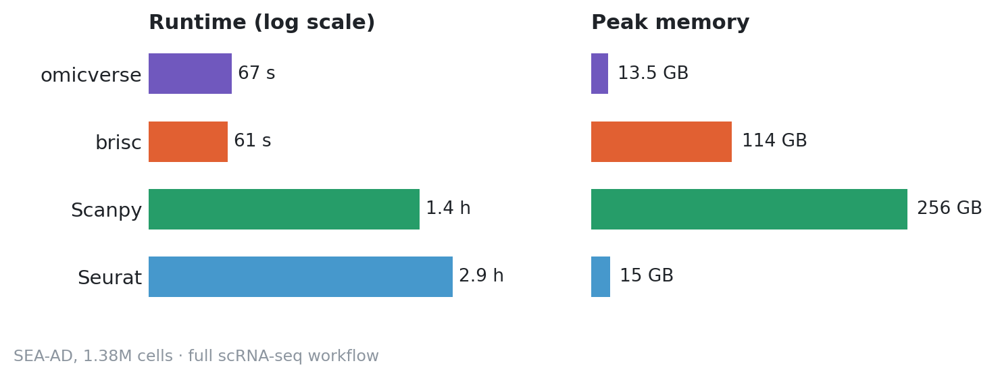

<div align="center">
  <a href="READMEM/README_CN.md">中文</a> | <a href="READMEM/README_ES.md">Español</a> | <a href="READMEM/README_JP.md">日本語</a> | <a href="READMEM/README_DE.md">Deutsch</a> | <a href="READMEM/README_FR.md">Français</a> | <a href="READMEM/README_KR.md">한국어</a>


|         |                                                                                                                                                  |
| ------- | ------------------------------------------------------------------------------------------------------------------------------------------------ |
| CI/CD   |  [![pre-commit.ci status][precommit-badge]][precommit-link]               |
| Docs    | [![Documentation Status][readthedocs-badge]][readthedocs-link] [![Preprint][preprint-badge]][preprint-link]                                            |
| Package | [![PyPI - Version][pypi-badge]][pypi-link] [![pypi download][pypi-download-badge]][pypi-download-link] [![Conda-forge badge][conda-forge-badge]][anaconda-link] [![Docker image][docker-badge]][docker-link] |
| Meta    | [![scverse-badge]][scverse-link] [![License][license-badge]][license-link] [![Star][star-badge]][star-link] [![Citations][citation-badge]][citation-link]           |


[precommit-badge]: https://github.com/Starlitnightly/omicverse/actions/workflows/python-package.yml/badge.svg
[precommit-link]:https://github.com/Starlitnightly/omicverse/actions/workflows/python-package.yml
[readthedocs-badge]:https://readthedocs.org/projects/omicverse/badge/?version=latest
[readthedocs-link]:https://omicverse.readthedocs.io/en/latest/?badge=latest
[preprint-badge]: https://img.shields.io/badge/DOI-10.1038/s41467.024.50194.3-368650.svg
[preprint-link]: https://doi.org/10.1038/s41467-024-50194-3
        
        
        
        
[pypi-badge]: https://img.shields.io/pypi/v/omicverse
[pypi-link]: https://pypi.org/project/omicverse
[pypi-download-badge]:https://static.pepy.tech/badge/omicverse
[pypi-download-link]:https://pepy.tech/project/omicverse
[conda-forge-badge]: https://img.shields.io/conda/dn/conda-forge/omicverse?logo=Anaconda
[anaconda-link]: https://anaconda.org/conda-forge/omicverse
[docker-badge]: https://img.shields.io/badge/docker-image-blue?logo=docker
[docker-link]: https://img.shields.io/docker/pulls/starlitnightly/omicverse
[license-badge]: https://img.shields.io/badge/license-GNU-blue
[license-link]: https://img.shields.io/apm/l/vim-mode
[scverse-badge]: https://img.shields.io/badge/scverse-ecosystem-blue.svg?labelColor=yellow
[scverse-link]: https://scverse.org/
[star-badge]:https://img.shields.io/github/stars/Starlitnightly/omicverse
[star-link]:https://github.com/Starlitnightly/omicverse
[citation-badge]:https://citations.njzjz.win/10.1038/s41467-024-50194-3
        
        
        
        
[citation-link]:https://doi.org/10.1038/s41467-024-50194-3
        
        
        
        

</div>


**`OmicVerse`** is the fundamental package for multi omics included **bulk ,single cell and spatial RNA-seq** analysis with Python. For more information, please read our paper: [OmicVerse: a framework for bridging and deepening insights across bulk and single-cell sequencing](https://www.nature.com/articles/s41467-024-50194-3)

> [!IMPORTANT]
>
> **Star Us**, You will receive all release notifications from GitHub without any delay \~ ⭐️
>
> If you like **OmicVerse** and want to support our mission, please consider making a [💗donation](https://ifdian.net/a/starlitnightly) to support our efforts.

<details>
  <summary><kbd>Star History</kbd></summary>
  <picture>
    <source media="(prefers-color-scheme: dark)" srcset="https://api.star-history.com/svg?repos=Starlitnightly%2Fomicverse&theme=dark&type=Date">
    
  </picture>
</details>


## `1` [Introduction][docs-feat-provider]

**OmicVerse v2** is a unified Python project for modern transcriptomics and multi-omics analysis. It brings together bulk RNA-seq, single-cell, spatial transcriptomics, downstream visualization, model-based analysis, and AI-assisted workflows in one package and documentation system.


### Speed and memory on 1.4M cells

<picture>
  <source media="(prefers-color-scheme: dark)" srcset="README.assets/benchmark_seaad_dark.png">
  
</picture>

<sub>CPU: omicverse 2.4.2 (`storage='disk'`), brisc and Seurat 6.0.0 (in-memory, `setThreads(64)`; RunUMAP segfaulted) on the same 128-core node. GPU: omicverse on one H100. Scanpy, Seurat + BPCells and rapids-singlecell (4× H100) from the brisc paper. [Scripts](https://github.com/omicverse/anndataoom-fast/tree/main/benchmarks/fig4)</sub>


## `2` [General Getting Started](#)

OmicVerse can be installed via conda or pypi and you need to install `pytorch` at first. Please refer to the [installation tutorial](https://starlitnightly.github.io/omicverse/Installation_guild/) for more detailed installation steps and adaptations for different platforms (`Windows`, `Linux` or `Mac OS`).

You can use `conda install omicverse -c conda-forge` or `pip install -U omicverse` for installation.

Please checkout the documentations and tutorials at [omicverse page](https://starlitnightly.github.io/omicverse/) or [omicverse.readthedocs.io](https://omicverse.readthedocs.io/en/latest/index.html).

Agent workflows — OpenClaw, the MCP server and the J.A.R.V.I.S. message bots — are documented in [OmicClaw](https://github.com/omicverse/omicclaw).

## `3` [Feature coverage](https://omicverse.readthedocs.io/en/latest/Feature_coverage/)

<picture>
  <source media="(prefers-color-scheme: dark)" srcset="README.assets/feature_coverage_dark.png">
  
</picture>

Feature coverage of omicverse, the scverse ecosystem and ten other frameworks over 75 audited analysis features. The full table with per-cell evidence, the data framework and the list of published tools included in OmicVerse are in the [documentation](https://omicverse.readthedocs.io/en/latest/Feature_coverage/).

## `4` [Contact](#)

- Zehua Zeng ([starlitnightly@gmail.com](mailto:starlitnightly@gmail.com) or [steorra@omicos.cn](mailto:steorra@omicos.cn))
- Meng Xu ([mengxu@omicos.cn](mailto:mengxu@omicos.cn))

## `5` [Developer Guild and Contributing](#)

If you would like to contribute to omicverse, please refer to our [developer documentation](https://omicverse.readthedocs.io/en/latest/Developer_guild/).

### Running tests locally

Install the test dependencies and execute the suite with `pytest`:

```bash
pip install -e .[tests]
# or install the pinned latest requirements
pip install -r requirements-latest.txt

pytest
```

The optional `tests` extra and the `requirements-latest.txt` file now include `pytest-asyncio>=0.23`, which is required for the asynchronous streaming tests under `tests/utils/`.

<table align="center">
    <tr>
      <th colspan="2">
        <br><br><br>
      </th>
    </tr>
</table>


> [!IMPORTANT]  
> We would like to thank the following WeChat Official Accounts for promoting Omicverse.
> <p align="center"> <a href="https://mp.weixin.qq.com/s/egAnRfr3etccU_RsN-zIlg" target="_blank" rel="noreferrer">  </a> <a href="https://zhuanlan.zhihu.com/c_1257815636945915904?page=3" target="_blank" rel="noreferrer">  </a> </p>


## `6` [Citation](https://doi.org/10.1038/s41467-024-50194-3)

If you use `omicverse` in your work, please cite the `omicverse` publication as follows:

> **OmicVerse: a framework for bridging and deepening insights across bulk and single-cell sequencing**
>
> Zeng, Z., Ma, Y., Hu, L. et al.
>
> _Nature Communication_ 2024 Jul 16. doi: [10.1038/s41467-024-50194-3](https://doi.org/10.1038/s41467-024-50194-3).

Here are some other related packages, feel free to reference them if you use them!

> **OmicOS: A Comprehensive Omics Ecosystem Infrastructure and Agent System for the AI Era**
>
> Zeng, Z., Meng, X., Hu, L. et al.
>
> _Biorxiv_ 2026 Jun 16. doi: [10.64898/2026.06.11.731775](https://doi.org/10.64898/2026.06.11.731775).

> **CellOntologyMapper: Consensus mapping of cell type annotation**
>
> Zeng, Z., Wang, X., Du, H. et al.
>
> _imetaomics_ 2025 Nov 06. doi: [10.1002/imo2.70064](https://doi.org/10.1002/imo2.70064).


## `7` [Other](#)

If you would like to sponsor the development of our project, you can go to the afdian website (https://ifdian.net/a/starlitnightly) and sponsor us.


Copyright © 2024 [112 Lab](https://112lab.asia/). <br />
This project is [GPL3.0](./LICENSE) licensed.

<!-- LINK GROUP -->
[docs-feat-provider]: https://starlitnightly.github.io/omicverse/
